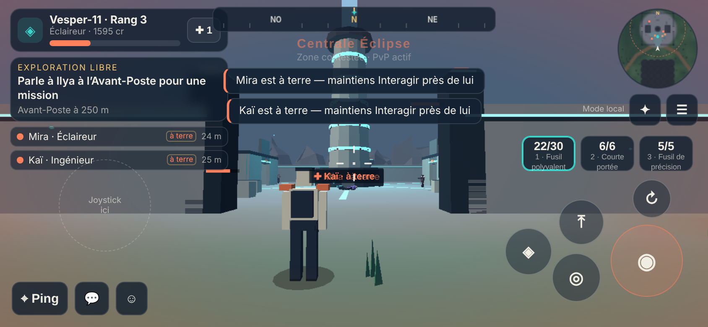

# FRACTURE — Secteur Éclipse

Prototype jouable de **FRACTURE MOBILE** : un TPS d'exploration en escouade, en 3D, jouable dans le navigateur d'un téléphone. Il sert à tester le plaisir de jeu avant l'alpha Unity décrite dans le cahier des charges (novembre 2026).



## Jouer

**En ligne : [eagleout.github.io/fracture_jeu](https://eagleout.github.io/fracture_jeu/)**, à ouvrir sur téléphone en mode paysage.

En local : ouvrir `index.html` (ou `dist/index.html`, identique) dans un navigateur récent. Le fichier est autonome : un seul HTML, sans dépendance ni serveur. GitHub Pages publie la branche `main` depuis la racine du dépôt.

Le premier lancement déroule la formation : crash, franchissement de la poutre, premier patrouilleur, arrivée à l'Avant-Poste. Ilya y donne les missions ; le tableau des escouades recrute les coéquipiers.

## Contenu

| Élément | Dans le prototype |
| --- | --- |
| Carte | Secteur Éclipse, 400 × 400 m : Avant-Poste (zone sûre), Ceinture Verte (2 itinéraires), Centrale Éclipse (zone contestée), Laboratoire 07 (caché) |
| Armes | Fusil polyvalent VX-7, fusil à pompe Brisant SG-4, fusil de précision Aiguille LR |
| Ennemis | Patrouilleur, Sentinelle (utilise les couvertures), Drone (signale ta position), Gardien 07 (ennemi spécial), escouade adverse « Cendre » |
| Escouade | 4 membres : opérateurs IA (Mira, Kaï, Dov) ou joueurs réels ; réanimation, pings, messages prédéfinis, emotes |
| Missions | A Reconnaissance, B Extraction, C Réactivation, puis D « Signal 07 » quand la Centrale est réactivée |
| Professions | Éclaireur (scan, points d'intérêt) et Ingénieur (relais, installation, réparation, nano-soin), avec réputation à paliers |
| Monde persistant | La Centrale passe de « hors service » à « réactivée » pour tous les joueurs, puis revient hors service après 24 h |
| Interfaces | Connexion, création du personnage, HUD, carte, missions, escouade, inventaire et armurerie, profession, journal, récompense, paramètres, signalement et blocage |

## Commandes

**Tactile** : joystick flottant à gauche (pousser vers le haut pour la course auto), glisser à droite pour la caméra, ◉ tirer (glisser sur le bouton oriente aussi la caméra), ◎ viser, ⤒ sauter, ↻ recharger, capacité de profession, 1-2-3 armes, bouton contextuel pour interagir.

**Clavier** : ZQSD/WASD déplacer · Maj courir · souris : caméra · F tirer · C viser · Espace sauter · R recharger · 1-3 armes · E interagir · Q capacité · T ping · G messages · H soin · M carte · Échap menu.

## Sauvegarde et multijoueur

- **Publié comme artefact claude.ai** : la progression est liée au compte, l'état de la Centrale est partagé par tous les joueurs, et les joueurs connectés se voient en temps réel (instances de 16). Les fonctions passent par `claude.use('db' | 'user' | 'room')`.
- **Ailleurs (fichier local, GitHub Pages)** : mode local. Progression et état de la Centrale restent dans le `localStorage` de l'appareil, sans présence des autres joueurs.

## Structure

| Fichier | Rôle |
| --- | --- |
| `src/engine.js` | Rendu WebGL minimal, maths, construction de maillages |
| `src/world.js` | Carte, collisions, lancer de rayons, zones |
| `src/game.js` | Joueur, IA, armes, missions, professions, autorité simulée, Centrale |
| `src/render.js` | Rendu de la scène, personnages, effets, caméra |
| `src/net.js` | Persistance, identité, présence temps réel, repli local |
| `src/ui.js` | Contrôles tactiles, HUD, panneaux, son synthétisé |
| `src/main.js` | Démarrage, écrans d'accueil, boucle principale |
| `src/index.html`, `src/style.css` | Gabarit et styles |
| `build.py` | Assemble `index.html` (racine, pour GitHub Pages) et `dist/index.html` |
| `tests/` | Parcours automatisés (Playwright) |

## Construire et tester

```bash
python3 build.py                 # régénère index.html et dist/index.html
pip install playwright           # une fois
python3 tests/test_play.py       # formation, 4 missions, Centrale, sauvegarde, rechargement
python3 tests/test_net.py        # monde partagé et présence, avec une plateforme simulée
```

Les tests lancent Chromium en headless (variable `CHROME_PATH` pour choisir un autre navigateur) et enregistrent des captures dans `tests/shots/`.

## Limites connues

- Chaque appareil simule ses propres ennemis : deux joueurs réels partagent l'escouade et l'objectif, pas les combats.
- L'autorité serveur (validation des tirs, récompenses, achats, journal) est simulée dans le client : elle montre le découpage, pas la protection contre la triche.
- Les performances web ne représentent pas celles d'un build Unity natif.
- Les visuels sont des formes simples aux couleurs de la palette officielle, pas la direction artistique cible.
- La carte fait un quart de la surface prévue (0,16 km² au lieu de 0,64 km²) pour garder des trajets courts pendant les tests.
